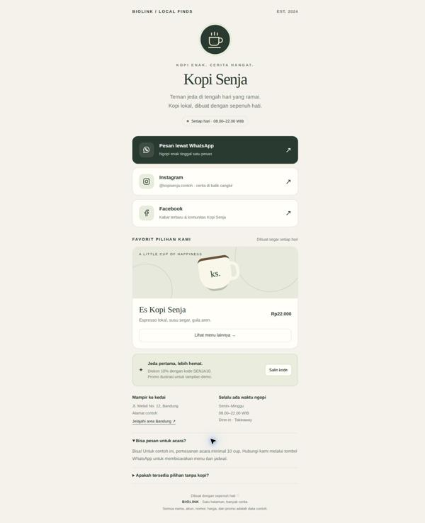

# Biolink-Web

Kumpulan template halaman biolink yang gratis, terbuka, dan mudah disesuaikan. Setiap template berada di folder tersendiri dan dapat digunakan secara mandiri tanpa instalasi paket atau proses build.

Anda boleh menggunakan dan memodifikasi template untuk kebutuhan pribadi, usaha, maupun proyek komersial sesuai [lisensi MIT](LICENSE). Sertakan salinan lisensi ketika membagikan ulang template.

## Koleksi template

| Template | Gaya | Sumber & panduan | Demo |
| --- | --- | --- | --- |
| Kopi Senja | Kedai kopi, hijau dan krem, logo SVG | [kopi-senja/](kopi-senja/) | [Buka demo](https://endyardhie.github.io/Biolink-Web/kopi-senja/) |
| Sobat Jastip | Jasa titip dan ekspedisi, hijau dan terracotta, seluruh data contoh | [Sobat Jastip/](Sobat%20Jastip/) | [Buka demo](https://endyardhie.github.io/Biolink-Web/Sobat%20Jastip/) |

[](kopi-senja/)

Demo memakai nama, akun sosial, nomor WhatsApp, alamat, menu, dan promo contoh. Ganti semua data tersebut sebelum memakai template untuk usaha Anda. Akun dan nomor contoh tidak dijamin tersedia atau dimiliki proyek ini.

## Mulai menggunakan

1. Unduh repo melalui **Code → Download ZIP**, atau clone:

   ```sh
   git clone https://github.com/endyardhie/Biolink-Web.git
   cd Biolink-Web
   ```

2. Pilih folder template, misalnya `kopi-senja/`.
3. Buka `index.html` di browser, lalu sesuaikan isi HTML, warna pada `styles.css`, serta kode promo pada `script.js`.
4. Unggah **seluruh isi folder template** ke hosting statis pilihan Anda. Pastikan `index.html` berada di direktori utama hasil unggahan, bersama `styles.css` dan `script.js`.

Untuk pratinjau melalui server lokal (jika Python tersedia):

```sh
python3 -m http.server 8000
```

Buka `http://localhost:8000/kopi-senja/`. Fitur salin kode memakai Clipboard API dan menyediakan dialog salin manual jika browser menolak akses clipboard.

## Demo di GitHub Pages

Demo dipublikasikan dari branch `main`, folder `/ (root)`. Kopi Senja tersedia di [GitHub Pages](https://endyardhie.github.io/Biolink-Web/kopi-senja/).

Setiap folder template baru dapat diakses pada `https://endyardhie.github.io/Biolink-Web/nama-folder/` setelah perubahan pada `main` selesai dipublikasikan oleh GitHub Pages. Pastikan folder memiliki `index.html` dan memakai jalur aset relatif.

## Struktur repo

```text
Biolink-Web/
├── README.md
├── CONTRIBUTING.md
├── LICENSE
├── Sobat Jastip/      # Template jasa titip dengan data contoh
└── kopi-senja/
    ├── index.html
    ├── styles.css
    ├── script.js
    ├── preview.jpg
    ├── README.md
    └── LICENSE
```

Folder template dapat disalin dan dihosting sendiri. Untuk menampilkan seluruh koleksi pada satu hosting, unggah root repo; template dapat diakses pada path `/kopi-senja/`. Repo ini belum menyediakan halaman katalog HTML pada root.

## Menambahkan template

Gunakan satu folder dengan nama huruf kecil dan tanda hubung untuk setiap template baru, misalnya `toko-bunga/`. Sertakan kode, pratinjau, panduan penggunaan, dan lisensi. Tambahkan baris pada tabel koleksi di atas.

Lihat [panduan kontribusi](CONTRIBUTING.md) untuk persyaratan lengkap.

## Lisensi

[MIT License](LICENSE) — gratis digunakan, dimodifikasi, dan didistribusikan, termasuk untuk penggunaan komersial, dengan menyertakan pemberitahuan hak cipta dan lisensi. Layanan hosting atau domain yang Anda pilih dapat memiliki biaya dan ketentuannya sendiri.
