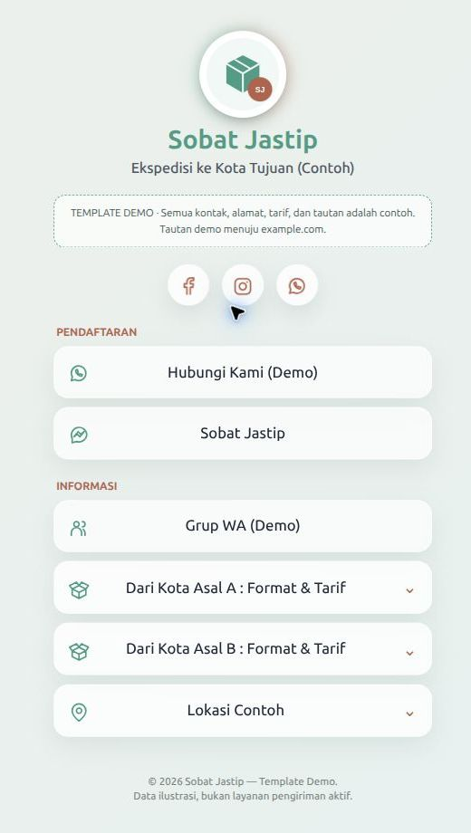

# Sobat Jastip — Template Demo

Template biolink jasa titip dan ekspedisi dengan tombol sosial, tautan pendaftaran, informasi tarif, format pengiriman, serta daftar lokasi dalam accordion.

[Buka demo GitHub Pages](https://endyardhie.github.io/Biolink-Web/Sobat%20Jastip/) · [Kembali ke koleksi](../README.md)



## Data contoh

Versi publik ini telah mengganti kontak, akun sosial, alamat, nama penerima, nama kota tujuan/asalan, tarif, jadwal, logo, tautan pendaftaran, grup, Messenger, dan lokasi dengan data ilustrasi. Folder ini tidak menyertakan logo asli, konfigurasi lokal, atau riwayat Git proyek sumber.

Semua tombol eksternal mengarah ke `https://example.com/sobat-jastip/...`, termasuk tombol berikon WhatsApp, Facebook, dan Instagram. Tautan tersebut adalah placeholder, bukan akun aktif, undangan grup, formulir pendaftaran, atau peta. Nomor `08xx-xxxx-0001` dan sejenisnya sengaja tidak bisa dihubungi.

Ini adalah demo tampilan; bukan penawaran jasa pengiriman atau tarif yang berlaku.

## Cara menggunakan

1. Salin seluruh folder `Sobat Jastip`.
2. Buka `index.html` di browser. Tidak perlu instalasi paket atau proses build untuk menjalankannya.
3. Ganti data contoh dengan identitas dan kontak usaha Anda sendiri.
4. Unggah isi folder ke hosting statis. Pastikan `index.html` berada pada root unggahan bersama CSS, JavaScript, dan logo.

Untuk meng-host seluruh repo, halaman tersedia pada `/Sobat%20Jastip/`. Nama folder memakai spasi sesuai nama template; spasi ditulis `%20` di URL.

## File dan penyesuaian

| File | Kegunaan |
| --- | --- |
| `index.html` | Identitas usaha, judul/metadata, tautan sosial dan pendaftaran, tarif, format alamat, lokasi, ikon SVG, dan footer |
| `style.css` | Gaya visual, gradient, ukuran komponen, accordion, dan dukungan pengurangan animasi |
| `utilities.css` | CSS utilitas Tailwind yang sudah dihasilkan agar halaman bisa berjalan tanpa CDN |
| `script.js` | Perilaku kursor dekoratif pada perangkat mouse; dinonaktifkan untuk layar sentuh dan preferensi pengurangan animasi |
| `logo.svg` | Logo paket generik untuk demo; ganti dengan logo usaha Anda |
| `preview.jpg` | Gambar dokumentasi; tidak dibutuhkan oleh halaman saat berjalan |
| `tailwind.config.cjs`, `tailwind.input.css` | Sumber konfigurasi untuk menghasilkan ulang CSS utilitas jika Anda menambahkan kelas Tailwind baru |
| `THIRD-PARTY-LICENSES.txt` | Lisensi CSS Tailwind yang disertakan |

Tidak ada font, icon-font, atau JavaScript dari CDN yang dimuat saat halaman berjalan. Ikon berupa SVG lokal dan font menggunakan font sistem.

Jika mengubah kelas Tailwind, hasilkan ulang `utilities.css` dari direktori template dengan Node.js dan npm:

```sh
npm exec --yes --package tailwindcss@3.4.17 -- tailwindcss -c tailwind.config.cjs -i tailwind.input.css -o utilities.css --minify
```

Untuk mengaktifkan tombol WhatsApp sungguhan, ganti placeholder dengan URL `https://wa.me/NOMOR_ANDA` menggunakan format nomor internasional tanpa `+`, spasi, atau tanda hubung. Ganti pula placeholder akun sosial, grup, pendaftaran, dan lokasi; jangan menyisakan tautan demo pada situs produksi.

## Lisensi

[MIT License](LICENSE). Gratis untuk digunakan dan dimodifikasi, termasuk penggunaan komersial, dengan menyertakan pemberitahuan hak cipta dan lisensi. CSS utilitas Tailwind juga berlisensi MIT; lihat [lisensi pihak ketiga](THIRD-PARTY-LICENSES.txt).
