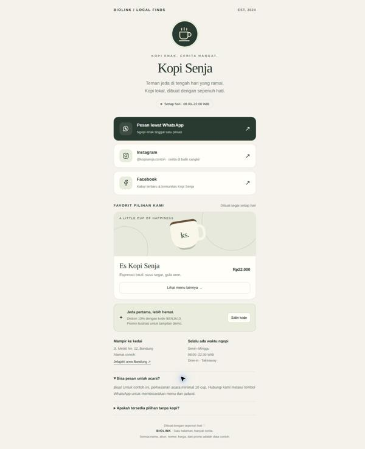

# Kopi Senja

Template biolink bertema kedai kopi dengan palet hijau dan krem. Dibuat menggunakan HTML, CSS, dan JavaScript biasa, tanpa framework, dependensi eksternal, atau proses build.

[Lihat demo](https://endyardhie.github.io/Biolink-Web/kopi-senja/) · [Kembali ke koleksi](../README.md)

## Fitur

- Header nama usaha dan logo cangkir SVG.
- Tombol WhatsApp, Instagram, dan Facebook.
- Kartu menu favorit serta dialog daftar menu.
- Tombol salin kode promo dengan alternatif salin manual.
- Informasi lokasi, jam buka, dan FAQ.
- Layout responsif, fokus keyboard, dan dukungan pengurangan animasi.

## Cara menggunakan

Salin seluruh folder ini. Buka `index.html` di browser untuk mencoba tampilannya. Untuk menerbitkannya, unggah seluruh isi folder ke hosting statis; `index.html`, `styles.css`, dan `script.js` harus berada pada direktori yang sama.

Untuk Cloudflare Pages dengan unggahan langsung, kompres **isi folder ini** menjadi ZIP dengan `index.html` di root ZIP. Untuk hosting yang terhubung ke Git, gunakan `kopi-senja` sebagai direktori hasil publikasi dan lewati proses build karena tidak ada kompilasi.

Versi ini berdiri sendiri dan tidak memerlukan Google Apps Script. Demo GitHub Pages mengikuti perubahan pada branch `main` setelah publikasi selesai. Perubahan di repo tidak otomatis mengubah versi Apps Script maupun salinan di hosting lain yang diunggah secara manual.

## Bagian yang dapat diubah

| File | Pengaturan |
| --- | --- |
| `index.html` | Judul halaman, nama usaha, tagline, SVG logo, teks tombol, akun sosial, nomor WhatsApp, menu dan harga, jam buka, alamat, tautan peta, FAQ, dan keterangan promo |
| `styles.css` | Variabel warna di `:root`, tipografi, ukuran, jarak, dan tampilan komponen |
| `script.js` | Kode promo `SENJA10`, pesan setelah menyalin, serta perilaku dialog menu |

Cari dan ganti **kedua** tautan `wa.me/6281234567890` (tombol utama dan tombol di dialog menu). Gunakan nomor internasional tanpa `+`, spasi, atau tanda hubung; contoh format Indonesia `628...`. Ubah juga pesan pada parameter `text` jika diperlukan.

Ganti `kopisenja.contoh` pada tautan Instagram/Facebook dan teks akun. Tautan peta demo hanya menuju pencarian area Bandung; ganti dengan tautan lokasi usaha Anda.

Kode promo muncul pada HTML dan JavaScript: ubah keduanya agar teks yang ditampilkan sesuai dengan teks yang disalin. Promo ini hanya menyalin teks; tidak menghitung atau memvalidasi diskon pesanan.

## Catatan demo

Semua identitas usaha, nomor, akun sosial, alamat, jam, produk, harga, dan promo adalah data contoh. Jangan menganggap akun atau nomor contoh tersebut milik proyek ini. Ganti sebelum digunakan secara nyata.

Logo dan ilustrasi cangkir dibuat dengan SVG/CSS sehingga tidak memerlukan gambar dari layanan luar. `preview.jpg` hanya untuk dokumentasi dan tidak dibutuhkan halaman saat berjalan.

## Lisensi

Template ini menggunakan [MIT License](LICENSE). Gratis untuk penggunaan pribadi dan komersial, modifikasi, serta distribusi ulang. Pertahankan salinan lisensi saat menyalin atau membagikannya.
